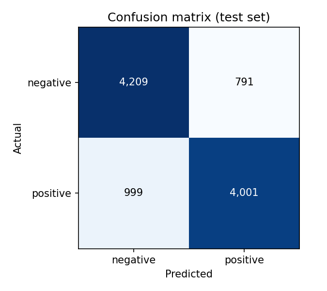

# Tweet Sentiment Analyzer (DistilBERT, CPU-only)

Fine-tunes DistilBERT to classify tweets as positive or negative, trained on a 500K-tweet subset of [Sentiment140](http://help.sentiment140.com/) on a laptop CPU (AMD Ryzen 5 4500U, 6 cores, 16 GB RAM, no GPU). It includes scripts to evaluate on a held-out test set and to label any CSV of text.

## Results

Every number here was produced by `scripts/evaluate.py` on test tweets the model never saw during training. The full metrics are in `reports/metrics.json`.

| Checkpoint | Training seen | Test rows | Accuracy | Macro F1 | Precision (pos) | Recall (pos) |
| --- | --- | --- | --- | --- | --- | --- |
| `checkpoint-500` | 16,000 tweets (4% of one epoch) | 10,000 (stratified sample of the 50K test split) | **82.10%** | **0.821** | 0.835 | 0.800 |

Confusion matrix for `checkpoint-500` (rows = actual, columns = predicted):

| | Predicted negative | Predicted positive |
| --- | --- | --- |
| **Actual negative** | 4,209 | 791 |
| **Actual positive** | 999 | 4,001 |



**Training status:** the full run is one epoch over 400,000 tweets (12,500 optimizer steps), which takes about 18 hours on this laptop. The table above is an early checkpoint. When training finishes, run `python scripts/evaluate.py` (full 50K test set, final model) and replace this table with that row.

### What the errors show

`reports/misclassified.csv` lists the model's most confident mistakes. Many are **label noise, not model errors**. Sentiment140 was labelled automatically from emoticons, so tweets like "thanks Kacie" and "what's so funny!" carry a *negative* label because the original tweet had a `:(`. Short, context-free tweets ("I don't know") are also genuinely ambiguous. This noise caps the accuracy any model can reach on this dataset.

## How it works

| Step | Script | Details |
| --- | --- | --- |
| Prepare | `scripts/preprocess.py` | Removes URLs and @mentions but keeps hashtags and emoticon punctuation. Takes a stratified 500K subset of the 1.6M tweets, then splits it 80/10/10 into **400K train / 50K val / 50K test**, label-balanced (`random_state=42`). |
| Train | `scripts/train.py` | `distilbert-base-uncased`, 1 epoch, batch 16 × 2 gradient accumulation (effective 32), learning rate 5e-5, max 48 tokens with dynamic padding. |
| Evaluate | `scripts/evaluate.py` | Accuracy, precision, recall, F1 and confusion matrix on the test split. Writes `reports/`. |
| Use | `scripts/inference.py` | CSV in, CSV out with `sentiment` and `confidence` columns added. |

### Training on a laptop CPU

The settings were chosen from measurements on this machine:
- **Threads:** 4 of 6. One batch of 16 took 2.63 s on 4 threads against 2.33 s on 6. Six threads was only 11% faster but left Windows no free cores, which made the laptop lag.
- **Speed and heat during the run:** about 5.2 s per optimizer step, hottest thermal zone 73 °C, CPU running at 125% of base clock. The CPU was boosting, not throttling.
- **Short sequences:** max 48 tokens with dynamic padding. Tweets are short, so most batches are much smaller than 48 tokens.
- **Checkpoints:** saved every 500 steps (about 45 minutes) and never deleted. A full epoch's checkpoints take about 19 GB (767 MB each).
- **Resume:** running `python scripts/train.py` again resumes from the latest checkpoint.
- **Run guard:** it refuses to start a second run while one is active (`logs/train.lock`), and refuses to retrain once `models/final` exists (unless you pass `--force`).

## Setup

```bash
python -m venv venv
source venv/Scripts/activate          # Windows Git Bash; venv/bin/activate on macOS/Linux
pip install -r requirements.txt
```

Data (not in the repo; too big, and it isn't ours to redistribute):

1. Download `trainingandtestdata.zip` from the Sentiment140 site (or Kaggle: `kazanova/sentiment140`).
2. Extract `training.1600000.processed.noemoticon.csv` and save it as `data/raw/sentiment140.csv`.
3. Run `python scripts/preprocess.py`.

## Usage

```bash
python scripts/train.py                                   # trains or resumes; TRAIN_THREADS=4 by default
python scripts/evaluate.py                                # final model, full 50K test set
python scripts/evaluate.py --model models/checkpoints/checkpoint-500 --limit 10000
python scripts/inference.py --input examples/sample_input.csv
python scripts/inference.py --text "Stuck in Nairobi traffic for 3 hours"
```

Example output of `inference.py --input examples/sample_input.csv` with `checkpoint-500`:

| text | sentiment | confidence |
| --- | --- | --- |
| Great match today, what a goal! | positive | 0.957 |
| Stuck in Nairobi traffic for 3 hours | negative | 0.932 |
| Thanks for the quick delivery | positive | 0.972 |

## Screenshots to take

1. **Training in progress:** the terminal or `logs/train.stderr.log` showing the progress bar (step x/12,500, s/it) and a loss line.
2. **Task Manager during training:** CPU around half used, with 2 cores' worth free, and RAM.
3. **`evaluate.py` output:** the classification report and confusion matrix in the terminal (redo after the final model).
4. **`reports/confusion_matrix.png`.**
5. **`inference.py --text ...`** on a few of your own sentences, including one it gets wrong, which makes for a good talking point.
6. **The `models/checkpoints/` folder** showing checkpoints every 500 steps, to illustrate resumable training.

## Project layout

```
scripts/preprocess.py     clean + subsample + split
scripts/train.py          fine-tune with checkpoints, resume and a run guard
scripts/evaluate.py       metrics, confusion matrix, misclassified examples
scripts/inference.py      label new text (CSV or command line)
scripts/predict_utils.py  shared model loading and batched prediction
reports/                  metrics.json and confusion_matrix.png from the latest evaluation
examples/                 a tiny sample CSV for inference
data/, models/, logs/     gitignored: dataset, weights and logs never go to GitHub
```
