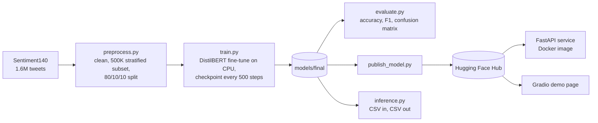

# Tweet Sentiment Analyzer


A DistilBERT model fine-tuned to classify short English text, such as tweets and reviews, as **positive** or **negative**. It was trained on 400,000 Sentiment140 tweets using only a laptop CPU, and it is served through a REST API, a Docker image and a public demo page.

**85.5% accuracy on 50,000 held-out test tweets.**

## Results

All numbers come from `scripts/evaluate.py`, run on the 50,000-tweet test split, which the model never saw during training. The full output is in `reports/metrics.json`.

| Model | Test tweets | Accuracy | Macro F1 | Precision (pos) | Recall (pos) |
| --- | --- | --- | --- | --- | --- |
| Final (1 epoch, 12,500 steps) | 50,000 | **85.52%** | **0.855** | 0.862 | 0.847 |
| Early checkpoint (500 steps) | 10,000 sample | 82.10% | 0.821 | 0.835 | 0.800 |

| | Predicted negative | Predicted positive |
| --- | --- | --- |
| **Actual negative** | 21,596 | 3,401 |
| **Actual positive** | 3,838 | 21,165 |


During training, the validation loss fell at each 2,500-step check: 0.383, 0.378, 0.335, 0.337, and finally 0.326.

### What the errors show
The model's most confident mistakes (`reports/misclassified.csv`) are mostly **label noise**. Sentiment140 was labelled automatically from emoticons, so a tweet like "thanks Kacie" carries a *negative* label because the original tweet ended in `:(`. Short, context-free tweets ("I don't know") are genuinely ambiguous. Together these set a ceiling on how accurate any model can be on this dataset.

## How the project fits together



```
sentiment/            shared package: text cleaning + model loading and prediction
scripts/              preprocess, train, evaluate, inference, publish_model
api/main.py           FastAPI service: POST /predict, GET /health, docs at /docs
demo/                 Gradio app for the public demo (Hugging Face Spaces)
tests/                API and text-cleaning tests (run without downloading the model)
Dockerfile            CPU image that serves the API
.github/workflows/    CI: lint, tests and Docker build on every push
reports/              metrics.json and confusion_matrix.png from the latest evaluation
```

Training data prep, evaluation, the API and the demo all use the same `sentiment` package. Text is cleaned the same way and the model is loaded the same way everywhere, so the API cannot quietly behave differently from what was evaluated.

## Use the API

```bash
pip install torch==2.3.1 --index-url https://download.pytorch.org/whl/cpu
pip install -r requirements-api.txt
uvicorn api.main:app --port 8000
```

```bash
curl -X POST localhost:8000/predict -H "Content-Type: application/json" \
  -d '{"texts": ["Stuck in Nairobi traffic for 3 hours", "Thanks for the quick delivery"]}'
```

```json
{
  "predictions": [
    {"text": "Stuck in Nairobi traffic for 3 hours", "sentiment": "negative", "confidence": 0.9901},
    {"text": "Thanks for the quick delivery", "sentiment": "positive", "confidence": 0.97}
  ],
  "model": "models/final",
  "elapsed_ms": 85.2
}
```

The API accepts up to 100 texts per request, and interactive docs are at `/docs`.

The model is read from `MODEL_SOURCE`, which can be:
- a local folder;
- a Hugging Face repo id;
- unset, in which case it uses `models/final` if present, otherwise the published model.

### With Docker

```bash
docker build -t sentiment-api .
docker run -p 8000:8000 sentiment-api                       # downloads the published model
docker run -p 8000:8000 -v ./models/final:/model -e MODEL_SOURCE=/model sentiment-api   # local weights
```

## Reproduce the training

```bash
python -m venv venv && source venv/Scripts/activate   # venv/bin/activate on macOS/Linux
pip install -r requirements.txt
```

1. **Get the data.** Download `trainingandtestdata.zip` from the Sentiment140 site, or from Kaggle as `kazanova/sentiment140`. Save `training.1600000.processed.noemoticon.csv` as `data/raw/sentiment140.csv`.
2. **Run the pipeline:**

```bash
python scripts/preprocess.py     # 400K train / 50K val / 50K test
python scripts/train.py          # about 18 hours on a 6-core laptop CPU; resumes after interruption
python scripts/evaluate.py       # writes reports/
python scripts/inference.py --input examples/sample_input.csv
```

### Training on a laptop CPU
The machine was an AMD Ryzen 5 4500U (6 cores, 15 W, 16 GB RAM), so the settings were chosen from measurements.

- **Threads:** 4 of 6. A batch of 16 took 2.63 s with 4 threads and 2.33 s with 6, so 6 threads is only 11% faster and leaves the OS no free cores, which made the laptop lag.
- **Temperature:** during the run the CPU held 73 °C at 125% of base clock. It was boosting, not throttling.
- **Short sequences:** max 48 tokens with dynamic padding, so batches are only as long as their longest tweet.
- **Checkpoints:** saved every 500 steps (767 MB each) and never deleted, so an interrupted run resumes where it stopped.
- **Run guard:** the script refuses to start a second run while one is active, and won't retrain over a finished model without `--force`.

| Setting | Value |
| --- | --- |
| Base model | `distilbert-base-uncased` |
| Epochs | 1 (12,500 optimizer steps) |
| Batch size | 16 × 2 gradient accumulation = 32 |
| Learning rate | 5e-5, linear decay |
| Max length | 48 tokens |
| Wall time | about 15.5 hours |

## Publish the model and the live demo

Both are free on Hugging Face. Create an account and a "Write" access token, then:

```bash
pip install -r requirements-dev.txt
huggingface-cli login
python scripts/publish_model.py
```

This uploads the model with a model card built from `reports/metrics.json`, and deploys the Gradio demo to a public page.

## Tests

```bash
pip install -r requirements-dev.txt
ruff check .
pytest
```

GitHub Actions runs the same checks and builds the Docker image on every push.

## Screenshots to take

1. The live demo page with a few of your own sentences.
2. `/docs` (Swagger UI) with a `/predict` call and its response.
3. `reports/confusion_matrix.png`.
4. The green CI run on GitHub Actions.
5. The `models/checkpoints/` folder, showing resumable training.
